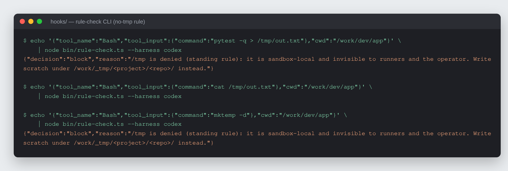
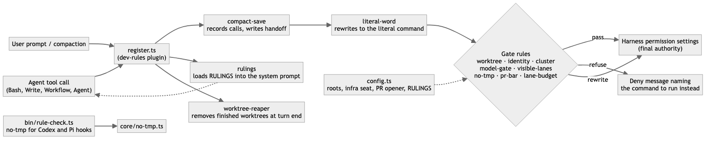

# Jeraptha

Guardrails that stop AI coding agents from repeating known mistakes, written
as tested Claude Code hooks instead of prompt text.

[](LICENSE)




*Real output of `hooks/bin/rule-check.ts`: a write into `/tmp` is refused
with the path to use instead, and a read from `/tmp` is allowed.*

## What it is

Jeraptha is a Claude Code plugin (`dev-rules`, v4) of twelve hook rules.
Each rule is a small TypeScript module with its own tests. A rule refuses a
tool call, rewrites it, or loads text into the prompt, and every refusal names
the command to run instead. The repo also ships the benchmark used to decide
which model and effort each kind of worker task gets (`bench/`).

## Why it exists

Agents read a rule, agree with it, and break it an hour later, usually in a
one-line reflex such as `> /tmp/out.txt`. Longer prompt files did not fix
that. Moving each rule that kept failing out of prose and into a hook did:

- **Deterministic first.** If a script can decide it, the hook decides it.
  Judgment calls stay as prose, and a hook (`rulings`) loads them into every
  turn so they are never out of view.
- **Refuse with the fix.** A refusal that only says "no" makes the agent try
  variants. Each refusal here names the right command.
- **Every rule has a test.** A rule that cannot fail a test is not a rule.
- **Not a security boundary.** The hooks read shell text and can be evaded on
  purpose. They catch mistakes. Safety gates (destructive deletes, secrets)
  belong in the harness permission settings, which still run beneath every
  call these hooks pass on.

## How it works



`hooks/hooks/register.ts` wires the rules in a fixed order. `compact-save`
runs first so it records every tool call, including ones a later gate
refuses. `literal-word` then rewrites indirect commands (`X=git; $X status`)
to the literal command, so the gates after it judge what actually runs. The
gate rules allow, rewrite or refuse; anything they pass still goes through
the harness's own permission settings. `hooks/hooks/config.ts` holds every
machine-specific value: the workspace roots, the infra checkouts, the PR
opener and the rulings text. `hooks/bin/rule-check.ts` exposes the `no-tmp`
decision as a CLI so Codex and Pi hooks can use the same logic.

## Features

| Rule | What it does |
|---|---|
| worktree | Denies `git worktree` in any spelling and the worktree tools; names the `wt` (worktrunk) command instead. |
| literal-word | Rewrites `X=git; $X status` to the literal command so later gates judge what actually runs. |
| identity | Adds `Agent: claude-code · <model> · <seat>` to commits and refuses an agent commit without it. |
| cluster | `kubectl`/`helm` reads stay open everywhere; changes only from the configured infra checkouts. |
| model-gate | Denies `claude -p` headless runs and an opt-in-only model unless an env flag is set. |
| visible-lanes | One agent per Workflow call, so every worker is its own visible row; no hidden background agents. |
| no-tmp | Denies writes, redirects, `mktemp` and `cd` into `/tmp` and similar paths, including through symlinks. Reads stay open. |
| pr-bar | Denies opening a forge PR except through your PR-opener script. |
| lane-budget | Denies polling loops: `ScheduleWakeup` under 30 minutes and crons more often than every 30 minutes. |
| rulings | Loads your one-line judgment rulings into the system prompt every turn. |
| compact-save | Before a compaction, writes a handoff file (the user's verbatim asks plus a model summary) and can roll over to a fresh session instead. |
| worktree-reaper | Removes linked worktrees whose branch is pushed and that hold nothing unsaved. |

`hooks/SPEC.md` is the full behaviour of each rule.

The benchmark in `bench/` replays finished tasks from a frozen commit, gives
every model the same frozen brief, and scores each run with hidden checks
the worker never sees. The 2026-10-03 round (6 tasks, 6 settings, 2 rounds)
is in `bench/results/`. Its task repo is private, so the harness ships with
an example task. See `bench/README.md`.

## Quick start

Needs Claude Code with plugin hooks (built and tested on 2.1.296) and Node 24
for the CLI and its tests (they run `.ts` files through Node's native type
stripping). The benchmark is plain `.mjs` and needs Node 22 or later.

```sh
git clone https://github.com/rodaddy/jeraptha.git
cd jeraptha/hooks
```

1. Edit `hooks/config.ts`: set `DEV_ROOT` and `TMP_ROOT` to your workspace
   and scratch roots, the infra checkouts and port-forward namespaces for
   `cluster`, your PR opener for `pr-bar`, and your own `RULINGS`. Rules
   apply only when a session's working directory is under one of the roots
   (the worktree rule applies everywhere).
2. Add the `hooks/` folder to `CLAUDE_CODE_PLUGIN_DIRS` in the `env` block of
   your Claude Code settings. It hot-reloads on save.

Check and test from `hooks/`:

```sh
claude plugin validate .
claude plugin test .
node --test bin/rule-check.spec.ts
```

Try the CLI on its own:

```sh
echo '{"tool_name":"Bash","tool_input":{"command":"ls > /tmp/x"},"cwd":"/work/dev/app"}' \
  | node bin/rule-check.ts --harness codex
```

The repo is MIT licensed: use it, change it and ship it, keeping the
copyright notice.

## Project status

Active. The twelve rules have run in the author's own Claude Code sessions
since early October 2026.

- 859 of 864 plugin tests pass under `claude plugin test .`; the 5 failures
  are in compact-save (turn-abort and session-append hooks return no result in
  the test engine; see `CHANGELOG.md`, known issues). All 47 CLI tests pass
  under `node --test bin/rule-check.spec.ts`.
- The public build moved paths, the infra seat list, the PR-opener name and
  the rulings text into `config.ts`. The tests pass against its defaults, but
  nobody else has run it yet.
- The rulings, deny messages and examples are the author's. Replace them with
  your own.

What it does not do: it is not a sandbox or a security control, it does not
run in other harnesses except the no-tmp CLI, and it does not score the
agent (v3 did; v4 dropped it).

v1 to v3 were an OpenClaw plugin for a single long-running agent: 21 gates,
a behavioural scorecard and a heartbeat. v4 is a rewrite for Claude Code and
many short-lived agents. See `CHANGELOG.md`.

## Credits

- [Claude Code](https://docs.anthropic.com/en/docs/claude-code) plugin hook
  engine.
- [worktrunk](https://github.com/max-sixty/worktrunk) (`wt`), the worktree
  tool the `worktree` rule points to.
- The name is from the Expeditionary Force books: the Jeraptha run a
  compliance office and bet on every outcome.

## Author

Rico Rojas, https://rico-rojas.com

Licensed under the MIT License. See [LICENSE](LICENSE).
